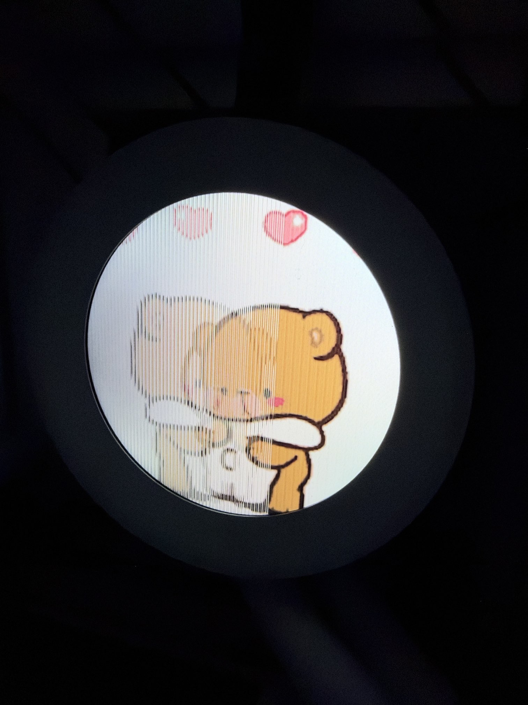

# kraken-tool

Diagnose and repair the LCD display controller of **NZXT Kraken Elite** AIO coolers
(Kraken Elite 2023 `1e71:300c`, Kraken Elite RGB 2024 `1e71:3012`; the 240×240
Kraken 2023 / 2024 Plus share the protocol and are supported best-effort).

It talks to the pump's display controller directly over USB, so it works whether or not
NZXT CAM is installed. **CAM must be fully closed while you use it** (exit it from the tray too).



*The symptom this tool was built for: in the moving region, the previous animation frame
shows through in alternating columns, while the static parts of the image are sharp.*

## Quick start

Download the binary for your OS from [Releases](../../releases) (or `pip install .`), close CAM, then:

```text
kraken-tool doctor            # read firmware, LCD state and the image-memory table; diagnose
kraken-tool repair my.gif     # reset LCD state, wipe image memory, re-upload a sanitised copy
```

## What "repair" actually fixes

The display controller keeps up to 16 uploaded images/GIFs in a flash area of
24,320 KiB, which is split into *buckets* (start address + size). Two kinds of damage
build up there and produce exactly the symptom above:

1. **Overlapping / out-of-range buckets.** Some uploaders (including older liquidctl
   allocators) reuse addresses incrementally. When two buckets overlap, writing one silently
   overwrites part of the other, and the decoder then mixes data from both assets.
   `doctor` reports this; `repair` deletes every bucket, verifies the table reads back
   empty, and writes the new asset at offset 0, so it cannot overlap anything.
2. **Delta-encoded GIFs.** Most GIFs store each frame as a small cropped rectangle with
   transparency, relying on the decoder's "disposal" handling to clear the previous frame.
   The Kraken's embedded decoder handles this badly, so earlier frames ghost through the
   regions that move. `upload` and `repair` re-encode every frame as a full, opaque,
   640×640 image (`disposal=2`, no transparency, own palette). `inspect-gif` shows whether
   a GIF has the problem.

## Isolating the fault

Run these in order and note what you see **with your eyes**. A phone camera can add its own
stripes, so judge by eye, not by the photo.

| Step | Command | If it looks clean | If it is still striped or ghosted |
|---|---|---|---|
| 1 | `kraken-tool repair` | The image memory was the problem: re-upload your GIF with `kraken-tool upload x.gif` | go to step 2 |
| 2 | `kraken-tool liquid` (built-in screen, no uploaded data) | go to step 3 | firmware or hardware: step 4 |
| 3 | `kraken-tool patterns` | panel and driver are fine, and the fault is in the asset: use `upload` (sanitised) | see the table below |
| 4 | `kraken-tool firmware`, then reinstall the firmware via CAM | fixed | hardware: warranty / RMA |

| Pattern | Fault it reveals |
|---|---|
| `white`, `black`, `red`, `green`, `blue` | dead or stuck rows and columns, a failing sub-pixel channel |
| `columns` (1 px lines) | column (source) driver faults: patchy shimmer or missing lines |
| `checker` | smearing, timing or overdrive problems |
| `gradient` | missing data bits: coarse banding in one colour |
| `grid` | geometry and orientation (the yellow square marks the top-left) |

If a **static** pattern shows stripes or ghosting, nothing in software will fix it. The
fault is in the panel, its flex cable or the timing controller. Kraken Elite coolers come with
a multi-year warranty, so open an NZXT support ticket and attach the pattern photos.

## About reflashing the controller firmware

`kraken-tool` **does not write the controller's program flash**. NZXT's bootloader protocol
and firmware images are not public, and the same MCU drives the pump. A bad write would
leave you with a cooler that does not pump, not just a broken screen. The safe way to
reflash is NZXT CAM: *Kraken › Settings › Firmware › Update / Reinstall*. Run
`kraken-tool wipe` first so the fresh firmware starts from an empty image table, then
`kraken-tool doctor` afterwards to confirm a clean state. `kraken-tool firmware` prints the
installed version and these steps.

If a public firmware-update protocol becomes available, it will be added here behind
explicit confirmation prompts.

## All commands

```text
list                      list connected Krakens
doctor                    diagnose (exit code 2 = image table damaged)
repair [FILE] [--raw]     full repair, optionally re-uploading FILE
wipe                      delete every stored image; show liquid temperature
pattern NAME              show one test pattern
patterns [--only ...]     step through the test patterns interactively
upload FILE [--raw]       upload a PNG/JPG/GIF (GIFs sanitised unless --raw)
liquid | brightness N | orientation DEG
firmware                  firmware version + safe reflash procedure
inspect-gif FILE          (offline) find delta/transparent frames
sanitize-gif IN OUT       (offline) re-encode a GIF as full opaque frames
-v                        log raw USB traffic (useful for bug reports)
```

## Platform notes

- **Windows**: no driver install is needed. The Kraken's bulk interface already uses WinUSB,
  and the binary bundles libusb.
- **Linux**: install `packaging/71-kraken-tool.rules` into `/etc/udev/rules.d/` (or run
  with sudo). The `nzxt-kraken3` hwmon driver can stay loaded.
- **macOS**: works via hidapi and libusb (`brew install libusb` when running from source).

## Development

```text
pip install -e ".[dev]"
pytest                      # includes a behavioural simulator of the controller (tests/fake_kraken.py)
python packaging/build.py   # single-file binary via PyInstaller
```

Releases are built by GitHub Actions when you push a `v*` tag.

Protocol knowledge comes from the [liquidctl](https://github.com/liquidctl/liquidctl) project's
reverse-engineering notes. Licensed GPL-3.0-or-later.
